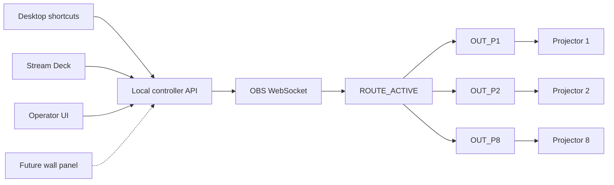

# Architecture

The T&V HDMI Floor Box Controller is a localhost appliance around OBS Studio. OBS owns capture, composition, calibration, and projector windows. The controller owns the operator workflow and is the only supported automation boundary.

## State ownership

| Concern | Owner |
| --- | --- |
| Capture-device identity and floor-box mapping | OBS source pool |
| Wraparound, lecture, multi-source, blank, and custom content | Logical OBS scenes |
| Active logical mode | `ROUTE_ACTIVE` scene-item visibility |
| Crop, scale, overlap, mask, warp, and projector assignment | `OUT_P1` through `OUT_P8` |
| Operator access and automation | Local controller |
| Known-good recovery | Backup/restore scripts and secured shared storage |

## Why `ROUTE_ACTIVE` exists

An OBS source projector for `OUT_P1` does not follow whichever scene happens to be Program. Every `OUT_Pn` scene therefore nests the same `ROUTE_ACTIVE` scene. `ROUTE_ACTIVE` contains all six logical scenes, with exactly one enabled.

The controller normalizes all route visibility on its first commissioned mode activation. Later changes enable the next full-canvas route before disabling the prior route. Projector geometry is never edited during this operation.

All routed scenes must be opaque across the full 11,860 x 1,080 canvas. That invariant prevents a one-frame reveal of the previous route while switching.

## Local API

The service listens on `127.0.0.1:8765` by default.

| Method | Path | Purpose |
| --- | --- | --- |
| `GET` | `/health` | Controller process health |
| `GET` | `/api/v1/config` | Public room and mode metadata |
| `GET` | `/api/v1/status` | OBS, scene, and output status |
| `POST` | `/api/v1/modes/{id}/activate` | Activate a room mode |
| `POST` | `/api/v1/outputs/open` | Open commissioned projector windows |
| `POST` | `/api/v1/editor/focus` | Restore and focus the OBS editor for the Custom workspace |
| `GET` | `/api/v1/obs/setup` | Inspect installation, process, WebSocket, and authentication readiness |
| `POST` | `/api/v1/obs/setup/launch` | Launch or focus the installed OBS instance |
| `PUT` | `/api/v1/obs/setup/websocket` | Back up and configure authenticated WebSocket access while OBS is closed |
| `PUT` | `/api/v1/obs/setup/password` | Store a manually chosen OBS password for the controller account without returning it |
| `GET` | `/api/v1/monitors` | Read OBS's current Windows monitor list |
| `GET` | `/api/v1/commissioning` | Normalized system, OBS-contract, stats, monitor, and output readiness |
| `POST` | `/api/v1/commissioning/inventory/refresh` | Refresh the read-only Windows hardware inventory |
| `PUT` | `/api/v1/commissioning/projectors/{id}` | Persist a confirmed monitor assignment and enabled state |
| `POST` | `/api/v1/commissioning/projectors/{id}/test` | Open one confirmed output for physical identification |

The API is intentionally bound to loopback. A future wall-panel bridge should authenticate at its own boundary and relay only the small command set above.

Custom Routing assigns one `FB_01` through `FB_08` source, or black, to each `CUSTOM_SLOT_P1` through `CUSTOM_SLOT_P8` scene. The browser changes scene-item visibility only. Slot transforms remain locked in OBS, and the controller has no mutation access to calibrated `OUT_Pn` transforms or filters.

The commissioning API intentionally has no scene-transform, crop, filter, mask, or warp mutation endpoint. Those measured values remain locked in OBS output scenes. Monitor-map and test calls require explicit `MAP Pn` or `TEST Pn` confirmation phrases.

## Credentials

The OBS WebSocket password is read from `OBS_WEBSOCKET_PASSWORD`. Guarded automatic setup can generate and persist that user environment value while updating OBS's own configuration. The password is never returned by the API or stored in `config/room.json`. Production backups can contain OBS authentication material and must remain on access-controlled storage.
