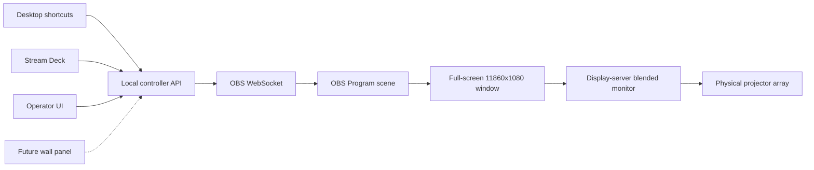

# Architecture

The T&V HDMI Floor Box Controller is a localhost appliance around OBS Studio.
OBS owns capture and composition, the display server owns physical blending, and
the controller owns the operator workflow and full-screen Program window.

## State ownership

| Concern | Owner |
| --- | --- |
| Capture-device identity and floor-box mapping | OBS source pool |
| Wraparound, lecture, multi-source, blank, and custom content | Logical OBS scenes |
| Active logical mode | OBS Program scene |
| Physical crop, overlap, mask, warp, and projector alignment | Display-server blend configuration |
| Full-screen Windows target | Controller output configuration |
| Operator access and automation | Local controller |
| Known-good recovery | Backup/restore scripts and secured shared storage |

## Single blended output

Windows sees the display server as one panoramic monitor. OBS renders one
11,860 x 1,080 Program canvas and opens one full-screen Program projector on
that monitor. Selecting a room mode changes the OBS Program scene; the
full-screen window follows it automatically.

The Multi-source scene divides that single canvas into eight logical regions
aligned with the physical projector positions. The display server—not OBS and
not this controller—owns the underlying projector seam and blend geometry.

## Local API

The service listens on `127.0.0.1:8765` by default.

| Method | Path | Purpose |
| --- | --- | --- |
| `GET` | `/health` | Controller process health |
| `GET` | `/api/v1/config` | Public room and mode metadata |
| `GET` | `/api/v1/status` | OBS, scene, and output status |
| `POST` | `/api/v1/modes/{id}/activate` | Activate a room mode |
| `POST` | `/api/v1/outputs/open` | Open OBS Program full-screen on the blended display |
| `POST` | `/api/v1/editor/focus` | Restore and focus the OBS editor for the Custom workspace |
| `GET` | `/api/v1/obs/setup` | Inspect installation, process, WebSocket, and authentication readiness |
| `POST` | `/api/v1/obs/setup/launch` | Launch or focus the installed OBS instance |
| `PUT` | `/api/v1/obs/setup/websocket` | Back up and configure authenticated WebSocket access while OBS is closed |
| `PUT` | `/api/v1/obs/setup/password` | Store a manually chosen OBS password for the controller account without returning it |
| `GET` | `/api/v1/monitors` | Read OBS's current Windows monitor list |
| `GET` | `/api/v1/commissioning` | Normalized system, OBS-contract, stats, monitor, and output readiness |
| `POST` | `/api/v1/commissioning/inventory/refresh` | Refresh the read-only Windows hardware inventory |
| `PUT` | `/api/v1/commissioning/projectors/{id}` | Persist the blended-monitor assignment and enabled state |
| `POST` | `/api/v1/commissioning/projectors/{id}/test` | Test OBS Program on the blended monitor |

The API is intentionally bound to loopback. A future wall-panel bridge should authenticate at its own boundary and relay only the small command set above.

Custom Routing assigns one `FB_01` through `FB_08` source, or black, to each
`CUSTOM_SLOT_P1` through `CUSTOM_SLOT_P8` logical region. The browser changes
scene-item visibility only. Slot transforms remain locked in OBS, and the
controller has no access to the display server's physical blend.

The commissioning API intentionally has no scene-transform, crop, filter, mask, or warp mutation endpoint. Those measured values remain locked in OBS output scenes. Monitor-map and test calls require explicit `MAP Pn` or `TEST Pn` confirmation phrases.

## Credentials

The OBS WebSocket password is read from `OBS_WEBSOCKET_PASSWORD`. Guarded automatic setup can generate and persist that user environment value while updating OBS's own configuration. The password is never returned by the API or stored in `config/room.json`. Production backups can contain OBS authentication material and must remain on access-controlled storage.
